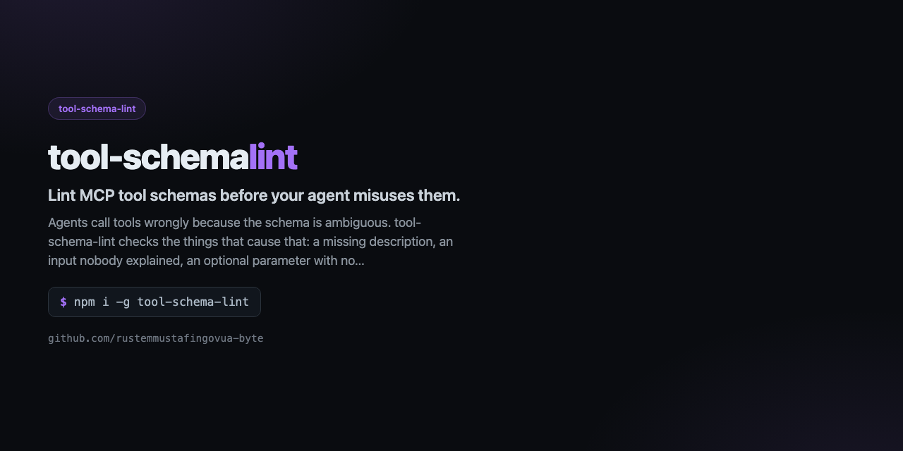

<div align="center">



# tool-schema-lint

**Lint MCP tool schemas before your agent misuses them.**

[](https://github.com/rustemmustafingovua-byte/tool-schema-lint/actions/workflows/ci.yml)
[](https://www.npmjs.com/package/tool-schema-lint)
[](./LICENSE)
[](https://nodejs.org)
[](https://base.org)

[**Docs**](https://rustemmustafingovua-byte.github.io/tool-schema-lint/) · [Issues](https://github.com/rustemmustafingovua-byte/tool-schema-lint/issues) · [Discussions](https://github.com/rustemmustafingovua-byte/tool-schema-lint/discussions)

</div>

---

Agents call tools wrongly because the schema is ambiguous. tool-schema-lint checks the things that cause that: a missing description, an input nobody explained, an optional parameter with no default, a string that should have been an enum, and a schema so big it eats the context.

## Install

```bash
# tarball из релиза: без токена и без npm-логина
npm i -g https://github.com/rustemmustafingovua-byte/tool-schema-lint/releases/download/v0.1.0/tool-schema-lint-0.1.0.tgz
```

<details>
<summary>Через GitHub Packages</summary>

```bash
npm i -g @rustemmustafingovua-byte/tool-schema-lint --registry=https://npm.pkg.github.com
```

</details>
## What it does

| | |
|---|---|
| **Real rules, not style** | missing description, vague description, optional without default, free-form string |
| **A score per tool set** | errors, warnings and the token cost of the schemas |
| **Suggested rewrites** | a description that names the required input |
| **Context cost** | how many tokens the tool definitions add to every request |


## Usage

```bash
tool-schema-lint tools.json
tool-schema-lint --stdin < tools.json
tool-schema-lint tools.json --suggest
```

## CLI

```
tool-schema-lint — Lint MCP tool schemas before your agent misuses them.

USAGE
  tool-schema-lint tools.json
  tool-schema-lint --stdin < tools.json
  tool-schema-lint tools.json --suggest

COMMANDS / OPTIONS
  --stdin    read the tool list from standard input
  --suggest  print a rewritten description for every tool with findings

Exit code 1 when a tool has an error-level finding.

MIT · https://github.com/rustemmustafingovua-byte
```

## Part of a portfolio

| Project | What it does |
|---|---|
| [`opencode-free-stack`](https://github.com/rustemmustafingovua-byte/opencode-free-stack) | route to free models, fall back automatically |
| [`free-web-mcp`](https://github.com/rustemmustafingovua-byte/free-web-mcp) | web search for agents, zero credits |
| [`agent-x402`](https://github.com/rustemmustafingovua-byte/agent-x402) | pay per API call in USDC with a spend policy |

## Donate

MIT, forever. USDC on Base:

```
0x8aC6a229f254980CCd3Dd35CF5E1B7c08880B40E
```

## License

MIT © rustemmustafingovua-byte
